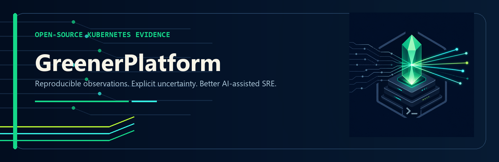

  

<h1 align="center">GreenerPlatform</h1>

  Open-source evidence tools for Kubernetes SRE: reproducible snapshots,
  provenance-bearing observations, and explicit uncertainty for AI-assisted investigations.

## Start here

[kubectl-sentinel](https://github.com/GreenerPlatform/kubectl-sentinel) collects a
point-in-time Kubernetes health report. It records what was checked, where the data came
from, and whether collection succeeded. Run it from source on Linux with `kubectl`, `jq`,
and a valid kubeconfig.

## Projects

- **[kubectl-sentinel](https://github.com/GreenerPlatform/kubectl-sentinel)** —
  severity-ranked observations across 15 Kubernetes health dimensions. JSON schema 1.2
  includes stable check IDs, evidence subjects, and collection status.
- **[incident-triage](https://github.com/GreenerPlatform/incident-triage)** —
  rule-based correlation of a normalized alert with a sentinel report. It produces ranked
  incident hypotheses, evidence gaps, and candidate response steps for operator review.
- **[greenerplatform-mcp](https://github.com/GreenerPlatform/greenerplatform-mcp)** —
  a thin MCP adapter for the two command-line tools. The host agent supplies the reasoning;
  the server does not contain a model.

## Evidence contract

GreenerPlatform aims to make operational claims inspectable. Evidence records identify
their source, scope, collection status, tool version, and check ID. Failed or unavailable
collection is evidence of a gap, not evidence of health.

Rule-based output can be reproducible without being complete or correct. Live snapshots
also span multiple Kubernetes API reads and are not atomic. Correlation is not causation,
and every suggested command requires operator review.

## Current maturity

The public tools are an **evidence substrate and partial evaluation harness**. Offline
fixture gates cover collection status, evidence gaps, EndpointSlice fallback, and typed
subject correlation. Live-cluster breadth, historical investigation, multi-source
evaluation, and team-utility measurement remain active work.

GreenerPlatform does not replace metrics, logs, traces, security tools, or incident
ownership. It is read-only by default and does not silently remediate workloads.

Read the [project vision](../VISION.md), then choose the repository that matches your
workflow. Each repository documents its supported installation path and current
limitations.
